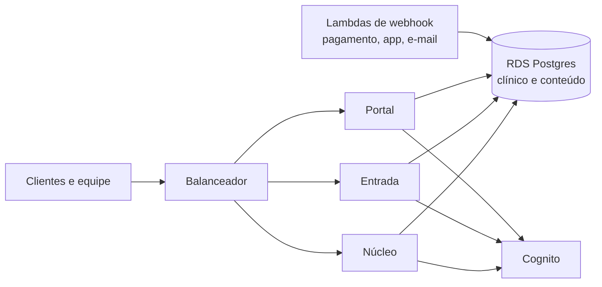
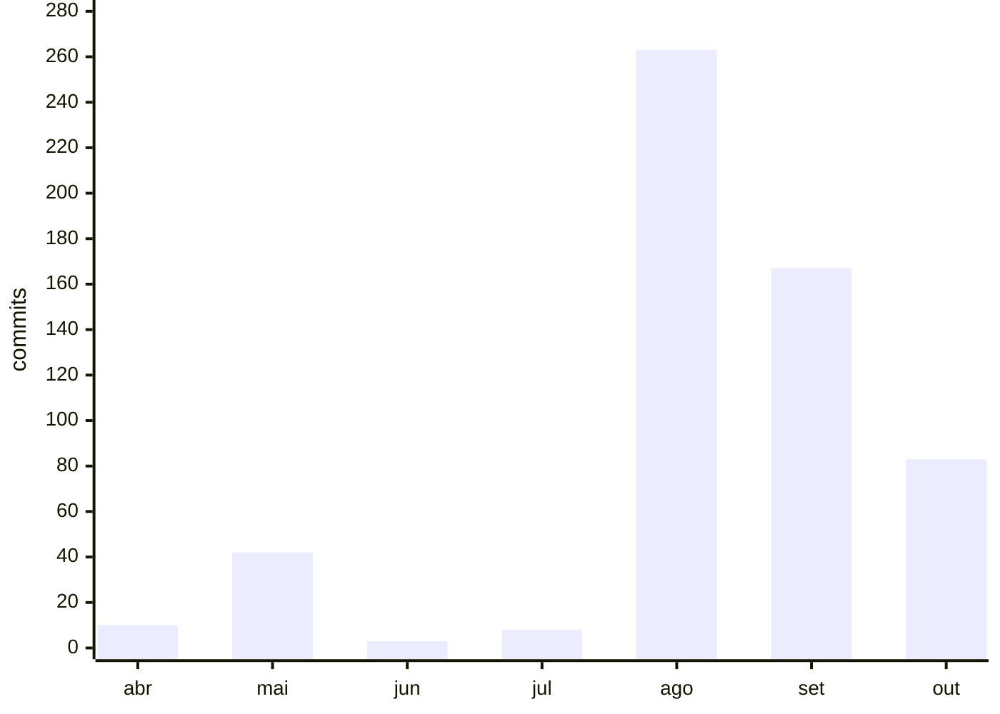

# Portfólio — Diogo Motta

O que construí entre 2025 e 2026. Os repositórios originais são privados, porque são o sistema em produção de uma empresa de saúde. Aqui está o que cada projeto resolve, como foi feito e o resultado.

## Plataforma de suplementos do Desafio Diabetes

O Desafio Diabetes vende suplementos por assinatura para pessoas com diabetes tipo 2, em sua maioria acima de 50 anos. A plataforma leva a pessoa do vídeo no YouTube a um quiz de triagem, a uma recomendação, à compra e à entrega todo mês. Liderei a construção inteira com agentes de IA (Claude Code e Cursor): 500 commits entre maio e outubro de 2026, 452 deles com o Claude como coautor, e 380 deploys.

O que ela faz:

- Pagamento recorrente por cartão e Pix, pela Pagar.me.
- Prescrição registrada e auditável, enviada a uma farmácia de manipulação parceira.
- Frete calculado e rastreado pela transportadora.
- E-mails transacionais e de relacionamento pelo Amazon SES, com recuperação de carrinho.
- Área do cliente, painel administrativo com visão 360 do cliente e relatório diário do funil.

Em agosto de 2026, migrei a plataforma da Vercel e do Supabase para a AWS:

Os três serviços (núcleo, entrada e portal) rodam a mesma imagem Next.js no ECS. A segurança dos dados de saúde fica em permissões por papel no próprio banco, e o registro de auditoria da prescrição só aceita inclusão.

## App Desafio Diabetes

App do Desafio Diabetes, feito em FlutterFlow. Levei o app de zero a 50 mil downloads, somando Android e iPhone.

## Canal do Dr. Turí no YouTube

Quando entrei, em junho de 2025, o canal tinha 88 vídeos públicos e 17 horas de conteúdo acumuladas em seis anos. Montei a operação de conteúdo: em 17 meses, foram 607 vídeos e 76 horas, que somam 54,6 milhões de views, 90% de tudo que o canal já teve. O canal tem hoje 360 mil inscritos.

## Site, blog e páginas de venda

Site institucional, blog e a landing page Primeiro Passo, com 42 commits e 10 deploys. O [quiz de triagem](https://github.com/diogo-desafiodbt/desafio-quiz) é público.

## CRM interno da DUX

CRM construído para o time comercial da DUX, fintech da Creator Economy em que fui Diretor Comercial. Foram 64 commits entre abril e maio de 2026. O código é da DUX e fica privado.

## Ritmo de trabalho

Commits por mês em todos os repositórios, abril a outubro de 2026:

O pico de agosto é a migração para a AWS. Em entrevista, mostro qualquer commit no repositório original.
